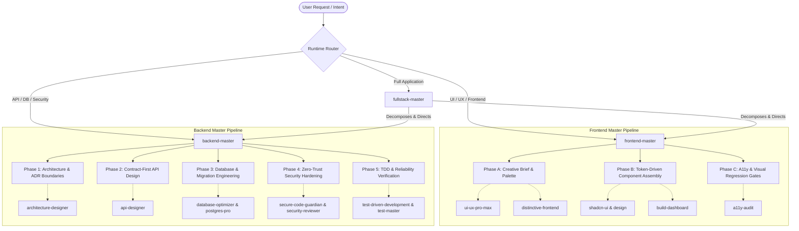

# Master Skills ⚡

[](https://github.com/MykeShale/master-skills)
[](https://github.com/MykeShale/master-skills)
[](https://github.com/MykeShale/master-skills)
[](https://github.com/MykeShale/master-skills)
[](LICENSE)

> **Autonomous multi-agent orchestration architecture for Antigravity & LLM coding runtimes.**  
> Transforms conversational LLMs into rigorous, production-grade software engineering teams through coordinated multi-agent skill lifecycles.

---

## 🏛️ System Architecture & Orchestration Model

Rather than relying on generic, unconstrained code generation, **Master Skills** operates on an **Orchestrated Capability Pipeline**. High-level master orchestrators evaluate the task context, establish architectural contracts, and coordinate specialized sub-skills across strict verification gates.



---

## 🎯 Flagship Master Orchestrators

### 1. `frontend-master`
*Lead Frontend Architect, Design Systems Lead & Visual Director*

* **Trigger**: Automatically activates on any prompt designing, building, styling, polishing, auditing, or refactoring user interfaces, dashboards, or components.
* **Core Philosophy**: Zero "AI Slop". Rejects generic default colors, bland Inter-only typography, unpadded cards, and weak visual hierarchy in favor of bespoke Linear/Stripe-tier design systems.
* **3-Phase Execution Pipeline**:
  - **Phase A (Design Direction & Creative Brief)**: Resolves domain-specific color palettes (1 brand primary + 4 semantic tokens + slate neutrals), high-contrast typography pairings (tight display headers + refined body), and deliberate layout density.
  - **Phase B (Architecture & Component Assembly)**: Enforces Design Token-first primitives (`theme.css` / `@theme`), complete state coverage (loading skeletons, interactive empty states, actionable error boundaries), and rich interactive data visualizations (Chart.js / Recharts / SVG).
  - **Phase C (Accessibility & Quality Gates)**: Strict WCAG 2.2 AA contrast enforcement (4.5:1 text, 3:1 graphical), full `:focus-visible` keyboard operability, responsive breakpoint verification (mobile, tablet, desktop), and zero type errors.

### 2. `backend-master`
*Principal Backend Architect, Lead Database Engineer & Security Specialist*

* **Trigger**: Automatically activates on any request to design, implement, review, optimize, debug, or test backend systems, microservices, databases, or APIs.
* **Core Philosophy**: Contract-first, zero-trust, and evidence-based engineering. Data outlives applications; APIs outlive implementations.
* **5-Phase Engineering Lifecycle**:
  - **Phase 1 (System Boundaries & ADRs)**: Concurrency expectations, data consistency models (strong vs. eventual), modular monolith prioritization, and formal Architectural Decision Records.
  - **Phase 2 (Contract-First API Design)**: OpenAPI / Zod schema contracts, standardized error objects (`{ code, message, details, timestamp }`), cursor-based pagination, and required `Idempotency-Key` headers on mutative routes.
  - **Phase 3 (Database Engineering & Invariants)**: Zero-downtime expand-contract schema migrations, deterministic indexing (B-tree, GIN), N+1 query elimination, and strict database-level constraints (`CHECK`, `FOREIGN KEY`, `NOT NULL`).
  - **Phase 4 (Security Hardening & Zero-Trust)**: Defends against OWASP Top 10 vulnerabilities, parameterized SQL enforcement, HTTP-only cookie JWT rotation, timing-safe equality checks, and Argon2id password hashing.
  - **Phase 5 (TDD & Production Reliability)**: Red-Green-Refactor test cycle, structured JSON logging with correlated `trace_id` and `request_id`, liveness/readiness probes (`/healthz`, `/readyz`), and graceful shutdown routines.

### 3. `fullstack-master`
*Autonomous Full-Stack Application Compiler*

* **Trigger**: Automatically activates when building, scaffolding, or generating full-stack applications or platforms from scratch.
* **Workflow**: Integrates `backend-master` and `frontend-master` into a 5-phase self-healing autonomous pipeline to deliver fully wired, seeded, tested, and running full-stack applications without manual intervention.

---

## 🗂️ Specialized Sub-Skills Directory

The repository includes a curated collection of 65+ domain-specific skills coordinated by the master orchestrators:

| Category | Skills Included | Description |
| :--- | :--- | :--- |
| **System Architecture** | `architecture-designer`, `microservices-architect`, `api-designer` | System boundary diagrams, ADR authoring, OpenAPI/REST modeling, and service decomposition. |
| **Database & Data Layer** | `database-optimizer`, `postgres-pro`, `sql-pro` | Query plan analysis (`EXPLAIN ANALYZE`), indexing strategies, JSONB optimization, and migration safety. |
| **Security & Compliance** | `secure-code-guardian`, `security-reviewer` | OWASP Top 10 prevention, authentication/authorization pipelines, input sanitization, and vulnerability auditing. |
| **Testing & Quality Assurance** | `test-driven-development`, `test-master`, `code-reviewer`, `systematic-debugging`, `verification-before-completion` | TDD test suites, E2E/integration testing, root-cause debugging, and mandatory evidence-before-completion checks. |
| **UI/UX & Design Systems** | `ui-ux-pro-max`, `distinctive-frontend`, `impeccable`, `design-tokens`, `brandkit`, `apply-aesthetic`, `superdesign`, `figma-integration`, `design-component`, `design-code`, `shadcn-ui`, `shadcn-ui-design` | 79 design styles, 192 product palettes, DTCG design tokens, Figma sync, and accessible component specs. |
| **SRE, Observability & Performance** | `sre-engineer`, `monitoring-expert`, `performance` | Prometheus/Grafana metrics, structured logging pipelines, SLI/SLO policies, and Core Web Vitals optimization. |
| **Motion & Cinematic Engineering** | `motion-design`, `motion-graphics`, `cinematic-camera`, `cinematic-film`, `remotion-*`, `sound-design`, `web-sims` | Programmatic React video creation, Remotion rendering, continuous camera choreography, and sound design. |

---

## ⚙️ Installation & Setup

### Option 1: Global Antigravity Customizations (Recommended)

Clone or link this repository directly into your Antigravity global configuration root:

```bash
# Windows (PowerShell)
git clone https://github.com/MykeShale/master-skills.git "$env:USERPROFILE\.gemini\config\skills"

# macOS / Linux
git clone https://github.com/MykeShale/master-skills.git ~/.gemini/config/skills
```

If you already manage a development workspace (e.g. `D:\My Systems\master-skills`), link the folder using a directory junction:

```powershell
New-Item -ItemType Junction -Path "D:\My Systems\master-skills" -Target "$env:USERPROFILE\.gemini\config\skills"
```

### Option 2: Project-Level Workspace Customizations

To enable `master-skills` exclusively for a specific repository, place it under `.agents/skills`:

```bash
mkdir -p .agents/skills
git clone https://github.com/MykeShale/master-skills.git .agents/skills
```

---

## 📐 Anatomy of a Master Skill

Every skill in this repository strictly adheres to the Antigravity Skill Specification:

```yaml
---
name: skill-identifier
description: >-
  Action-oriented, unambiguous description declaring exactly WHEN and HOW the skill
  must be activated, along with its coordinated dependencies.
---

# Skill Title — Formal Domain Role
Directive and persona grounding.

## 1. Execution Pipeline
Structured, phased checklists with deterministic inputs and outputs.

## 2. Invariants & Guardrails
Non-negotiable constraints, forbidden patterns, and quality gates.
```

---

## 🛡️ Engineering Guarantees & Invariants

1. **Evidence Before Assertions**: Skills never report a task as completed without running the relevant test suites, linters, or builds and confirming real exit status `0`.
2. **Zero Hardcoded Design Tokens**: No magic hex codes (`#1a1a1a`) or ad-hoc pixel values. All UI must derive from semantic design tokens.
3. **Contract-First Stability**: Backends freeze database invariants, validation schemas (Zod/OpenAPI), and error payloads before writing controller logic.
4. **Accessibility as a Blocker**: UIs must pass WCAG 2.2 AA contrast checks and maintain visible focus rings and keyboard traps prevention.

---

## 🤝 Contributing

Contributions to improve and expand the skills catalog are welcome!

1. Fork the repository.
2. Create your feature branch (`git checkout -b feat/new-skill`).
3. Ensure your `SKILL.md` includes valid YAML frontmatter and concrete, actionable instructions.
4. Commit your changes (`git commit -m "feat: add cloud-native-deploy skill"`).
5. Push to the branch (`git push origin feat/new-skill`).
6. Open a Pull Request.

---

## 📄 License

Distributed under the **MIT License**. See `LICENSE` for more information.

---

<div align="center">
  <sub>Crafted for next-generation autonomous software engineering by <b>Myke Shale</b>.</sub>
</div>
