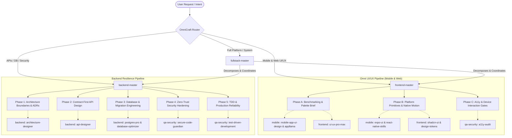

# OmniCraft ⚡

[](https://github.com/MykeShale/OmniCraft)
[](https://github.com/MykeShale/OmniCraft)
[](https://github.com/MykeShale/OmniCraft)
[](https://github.com/MykeShale/OmniCraft)
[](https://github.com/MykeShale/OmniCraft)
[](LICENSE)

> **Autonomous multi-platform engineering & agent orchestration suite.**  
> Unifies benchmark-grade mobile app UI/UX (Expo, React Native, iOS & Android), modern web applications, and resilient backend systems into 7 organized domain modules.

---

## 🗂️ Clean 7-Domain Architecture

OmniCraft organizes 100+ specialized skills into 7 dedicated domain directories:

```text
OmniCraft/
├── 📁 orchestrators/     # Flagship Autonomous Master Orchestrators & Compilers
├── 📁 mobile/            # Native Mobile UI/UX, Expo, React Native & App Store Deployments
├── 📁 frontend/          # Modern Web SaaS, Design Systems, Tokens & Typography
├── 📁 backend/           # System Architecture, API Contracts & Database Engineering
├── 📁 qa-security/       # TDD Pipelines, Security Hardening & Zero-Trust Auditing
├── 📁 devops-cloud/      # SRE Reliability, Observability & Cloud Performance
├── 📁 motion-video/      # Programmatic Video, Continuous Cameras & Audio FX
├── 📄 skills.json        # Auto-registration config for Antigravity & LLM agents
├── 📄 README.md          # Architecture & Documentation
└── 📄 LICENSE            # MIT License
```

---

## 🧭 Domain Directory Map

| Domain Folder | Core Scope & Capabilities | Highlight Skills |
| :--- | :--- | :--- |
| [📁 `orchestrators/`](./orchestrators) | **Master Orchestrators & Compilers**: Directs and executes full-stack pipelines, freezes intent contracts, and coordinates sub-skills. | `frontend-master`, `backend-master`, `fullstack-master` |
| [📁 `mobile/`](./mobile) | **Mobile UI/UX & Native Platforms**: Apple HIG fidelity, Expo Router navigation, native bottom sheets, touch targets, and Reanimated physics. | `mobile-app-ui-design`, `appllama-app-design-skill`, `expo-ui`, `expo-native-ui`, `expo-router`, `react-native-skills`, `eas-*` |
| [📁 `frontend/`](./frontend) | **Web UI/UX & Design Systems**: Anti-slop typography, 79 visual styles, 192 product palettes, DTCG design tokens, and shadcn primitives. | `ui-ux-pro-max`, `distinctive-frontend`, `impeccable`, `shadcn-ui`, `design-tokens`, `brandkit`, `build-dashboard` |
| [📁 `backend/`](./backend) | **Architecture & Data Engineering**: Formal ADRs, modular monoliths, contract-first OpenAPI schemas, and zero-downtime DB migrations. | `architecture-designer`, `microservices-architect`, `api-designer`, `postgres-pro`, `sql-pro`, `database-optimizer` |
| [📁 `qa-security/`](./qa-security) | **Quality, TDD & Security**: Red-Green-Refactor test suites, OWASP Top 10 defense, zero-trust auth, and automated WCAG 2.2 AA gates. | `test-driven-development`, `test-master`, `secure-code-guardian`, `security-reviewer`, `code-reviewer`, `a11y-audit` |
| [📁 `devops-cloud/`](./devops-cloud) | **Cloud & Production Reliability**: Prometheus/Grafana metrics, SLI/SLO budgets, structured JSON logging, and Vercel cloud scaling. | `sre-engineer`, `monitoring-expert`, `performance`, `deploy-to-vercel`, `vercel-optimize` |
| [📁 `motion-video/`](./motion-video) | **Motion Graphics & Media**: Programmatic canvas video generation, continuous 3D camera paths, and procedural sound design. | `motion-design`, `motion-graphics`, `cinematic-camera`, `cinematic-film`, `sound-design`, `remotion-*` |

---

## 🏛️ System Architecture: The OmniCraft Pipeline



---

## 🎯 Flagship Master Orchestrators

### 1. `frontend-master`
*Lead UI/UX Architect, Mobile Experience Director & Design Systems Lead*
* **Location**: [`orchestrators/frontend-master`](./orchestrators/frontend-master)
* **Scope**: Responsive Web, Native Mobile Apps (Expo, React Native, iOS, Android).
* **Core Philosophy**: Zero "AI Slop". Rejects generic purple gradients and unstyled system fonts in favor of benchmark-grade craft (Airbnb, Linear, Apple, Spotify).

### 2. `backend-master`
*Principal Backend Architect, Lead Database Engineer & Security Specialist*
* **Location**: [`orchestrators/backend-master`](./orchestrators/backend-master)
* **Scope**: Distributed Services, Modular Monoliths, REST/GraphQL APIs, and Database Engines.
* **Core Philosophy**: Contract-first, zero-trust, and evidence-driven engineering. Data outlives applications; APIs outlive implementations.

### 3. `fullstack-master`
*Autonomous Full-Stack Application Compiler*
* **Location**: [`orchestrators/fullstack-master`](./orchestrators/fullstack-master)
* **Scope**: End-to-end full-stack platforms from scratch.
* **Workflow**: Integrates `backend-master` and `frontend-master` into a 5-phase self-healing autonomous loop.

---

## ⚙️ Installation & Setup

### Global Antigravity Installation (Recommended)

Clone into your global Antigravity config directory:

```bash
# Windows (PowerShell)
git clone https://github.com/MykeShale/OmniCraft.git "$env:USERPROFILE\.gemini\config\skills"

# macOS / Linux
git clone https://github.com/MykeShale/OmniCraft.git ~/.gemini/config/skills
```

Antigravity automatically discovers and indexes all categorized domains via [`skills.json`](./skills.json).

---

## 🛡️ Engineering Guarantees

1. **Evidence Before Assertions**: Real verification output (passing test runs, clean builds, zero lint warnings) required before declaring work complete.
2. **Zero Hardcoded Design Values**: All visual properties derive from semantic design tokens, ensuring cohesive theming.
3. **Contract-First Stability**: Backends freeze database schemas, validation models, and error responses before business logic is written.
4. **Inclusive Accessibility**: UIs strictly enforce WCAG 2.2 AA contrast ratios, mobile touch targets (>= 48dp), and accessible ARIA/keyboard navigation.

---

## 📄 License

Distributed under the **MIT License**. See [`LICENSE`](./LICENSE) for details.

---

<div align="center">
  <sub>Crafted for autonomous cross-platform engineering by <b>Myke Shale</b>.</sub>
</div>
