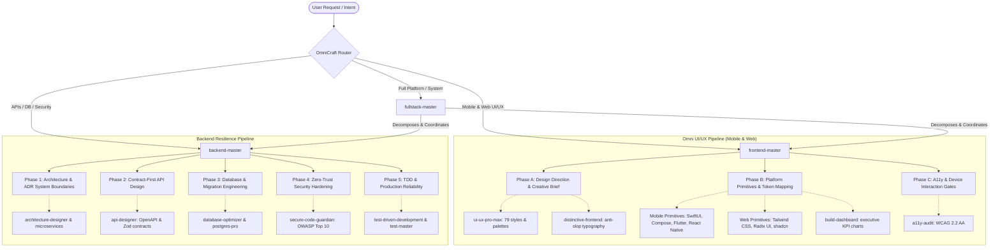

# OmniCraft ⚡

[](https://github.com/MykeShale/OmniCraft)
[](https://github.com/MykeShale/OmniCraft)
[](https://github.com/MykeShale/OmniCraft)
[](https://github.com/MykeShale/OmniCraft)
[](https://github.com/MykeShale/OmniCraft)
[](LICENSE)

> **Autonomous multi-platform engineering & agent orchestration suite.**  
> Unifies native mobile UI/UX (iOS & Android), responsive web applications, and resilient backend systems under coordinated multi-agent engineering lifecycles.

---

## 🏛️ System Architecture: The OmniCraft Pipeline

Rather than unstructured code generation, **OmniCraft** enforces an **Orchestrated Multi-Platform Pipeline**. High-level orchestrators evaluate platform requirements, enforce design systems, and coordinate deep specialized sub-skills through automated verification gates.



---

## 📱 Cross-Platform Coverage Matrix

OmniCraft spans the entire technology spectrum from distributed databases to high-framerate mobile animations:

| Domain | Supported Stacks & Targets | Quality Invariants |
| :--- | :--- | :--- |
| **Mobile UX (iOS & Android)** | **SwiftUI**, **Jetpack Compose**, **Flutter**, **React Native** | Touch targets (min 48×48dp), dynamic typography scales, dark mode tokens, safe area padding, 60/120fps motion fluidity. |
| **Modern Web & SaaS** | **Next.js**, **React**, **Vue/Nuxt**, **Svelte**, **Vite** | Token-driven styles, responsive breakpoints, semantic HTML5, zero stray hardcoded hex values, SSR/hydration safety. |
| **Backend & Services** | **Node.js**, **Go**, **Python/FastAPI**, **PostgreSQL**, **Redis** | Contract-first OpenAPI schemas, expand-contract DB migrations, parameterized queries, rate limiting, and zero-trust auth. |
| **Motion & Video** | **Remotion**, **Three.js**, **CSS/SVG Motion** | Programmatic canvas rendering, continuous camera choreographies, and asset pipelines. |

---

## 🎯 Flagship Master Orchestrators

### 1. `frontend-master`
*Lead UI/UX Architect, Mobile Experience Lead & Design Systems Director*

* **Scope**: Responsive Web, Native Mobile Apps (iOS/Android), and Cross-Platform Frameworks.
* **Core Philosophy**: Zero "AI Slop". Rejects boilerplate purple gradients, default system fonts, and generic unpadded cards in favor of bespoke Linear/Stripe-tier craftsmanship.
* **3-Phase Execution Pipeline**:
  - **Phase A (Design Direction & Creative Brief)**: Identifies domain palettes (1 brand primary + 4 semantic tokens + neutral slates), high-contrast typography scales, and platform-specific ergonomics.
  - **Phase B (Platform Component Assembly)**: Enforces Design Token-first primitives, comprehensive state coverage (skeletons, empty states, contextual error banners), and mobile-responsive interactions.
  - **Phase C (Accessibility & Quality Gates)**: WCAG 2.2 AA contrast compliance (4.5:1 text, 3:1 non-text), visible `:focus-visible` rings, touch target boundaries, and zero type errors.

### 2. `backend-master`
*Principal Backend Architect, Lead Database Engineer & Security Specialist*

* **Scope**: Distributed Services, Monoliths, REST/GraphQL APIs, and Database Engines.
* **Core Philosophy**: Contract-first, zero-trust, and evidence-driven engineering. Data outlives applications; APIs outlive implementations.
* **5-Phase Engineering Lifecycle**:
  - **Phase 1 (System Boundaries & ADRs)**: Concurrency modeling, consistency boundaries, modular monolith prioritization, and formal ADR records.
  - **Phase 2 (Contract-First API Design)**: OpenAPI / Zod schema contracts, standardized error models, cursor pagination, and mandatory idempotency headers.
  - **Phase 3 (Database Engineering & Invariants)**: Safe zero-downtime expand-contract migrations, deterministic B-tree/GIN indexing, N+1 query prevention, and integrity constraints.
  - **Phase 4 (Security Hardening & Zero-Trust)**: Parameterized SQL, row-level security / multi-tenant isolation, rotating JWT cookies, and Argon2id password hashing.
  - **Phase 5 (TDD & Reliability Verification)**: Red-Green-Refactor test suites, structured JSON logging with distributed trace propagation, health probes (`/healthz`, `/readyz`), and graceful teardown routines.

### 3. `fullstack-master`
*Autonomous Full-Stack Application Compiler*

* **Scope**: End-to-end applications from scratch.
* **Workflow**: Synthesizes product intent into frozen data contracts, orchestrates `backend-master` and `frontend-master` in parallel, validates cross-system integration, and self-heals build errors autonomously.

---

## 🗂️ Specialized Sub-Skills Catalog

OmniCraft coordinates a suite of 65+ specialized skills:

| Domain | Key Skills | Capabilities |
| :--- | :--- | :--- |
| **Mobile & Web UI/UX** | `ui-ux-pro-max`, `distinctive-frontend`, `impeccable`, `design-tokens`, `brandkit`, `apply-aesthetic`, `superdesign`, `design-component`, `design-code`, `shadcn-ui`, `figma-integration` | 79 visual styles, 192 product palettes, DTCG tokens (color, spacing, motion, radius), Figma sync, and code generation across SwiftUI, Compose, Flutter, and Web. |
| **Architecture & Systems** | `architecture-designer`, `microservices-architect`, `api-designer` | System boundary modeling, microservices decomposition, ADR documentation, and REST/GraphQL specs. |
| **Data & Databases** | `database-optimizer`, `postgres-pro`, `sql-pro` | Query plan analysis (`EXPLAIN ANALYZE`), indexing strategies, JSONB acceleration, and migration safety. |
| **Security & Hardening** | `secure-code-guardian`, `security-reviewer` | OWASP Top 10 defense, zero-trust auth, secure cookie handling, input validation with Zod, and security audits. |
| **Testing & Quality Assurance** | `test-driven-development`, `test-master`, `code-reviewer`, `systematic-debugging`, `verification-before-completion`, `a11y-audit` | Red-Green-Refactor pipelines, E2E/integration testing, root-cause isolation, and evidence-first completion gates. |
| **SRE, Observability & Vitals** | `sre-engineer`, `monitoring-expert`, `performance` | Prometheus/Grafana telemetry, structured logging pipelines, SLI/SLO budgets, and Core Web Vitals profiling. |
| **Motion & Cinematic** | `motion-design`, `motion-graphics`, `cinematic-camera`, `cinematic-film`, `remotion-*`, `sound-design` | Programmatic video generation with Remotion, three.js continuous scenes, procedural sound design, and media pipelines. |

---

## ⚙️ Installation & Workspace Setup

### Global Antigravity Installation (Recommended)

Clone into your global Antigravity config directory:

```bash
# Windows (PowerShell)
git clone https://github.com/MykeShale/OmniCraft.git "$env:USERPROFILE\.gemini\config\skills"

# macOS / Linux
git clone https://github.com/MykeShale/OmniCraft.git ~/.gemini/config/skills
```

For seamless local development, link your workspace to the active runtime using a junction:

```powershell
New-Item -ItemType Junction -Path "D:\My Systems\OmniCraft" -Target "$env:USERPROFILE\.gemini\config\skills"
```

---

## 🛡️ Engineering Guarantees

1. **Evidence Before Assertions**: Real verification output (passing test runs, clean builds, zero lint warnings) required before declaring work complete.
2. **Zero Hardcoded Design Values**: All visual properties derive from semantic design tokens, ensuring cohesive theming across light, dark, and brand variants.
3. **Contract-First Stability**: Backends freeze database schemas, validation models, and error responses before business logic is written.
4. **Inclusive Accessibility**: UIs strictly enforce WCAG 2.2 AA contrast ratios, touch targets, and accessible ARIA/keyboard navigation.

---

## 🤝 Contributing

Contributions to improve and expand the OmniCraft skills ecosystem are welcome!

1. Fork the repository.
2. Create your feature branch (`git checkout -b feat/new-skill`).
3. Follow the Antigravity `SKILL.md` specification with YAML frontmatter.
4. Commit your changes (`git commit -m "feat: add mobile-animation-engine skill"`).
5. Push to the branch (`git push origin feat/new-skill`).
6. Open a Pull Request.

---

## 📄 License

Distributed under the **MIT License**. See `LICENSE` for details.

---

<div align="center">
  <sub>Crafted for autonomous cross-platform engineering by <b>Myke Shale</b>.</sub>
</div>
